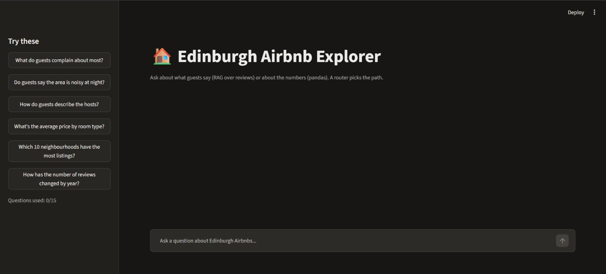
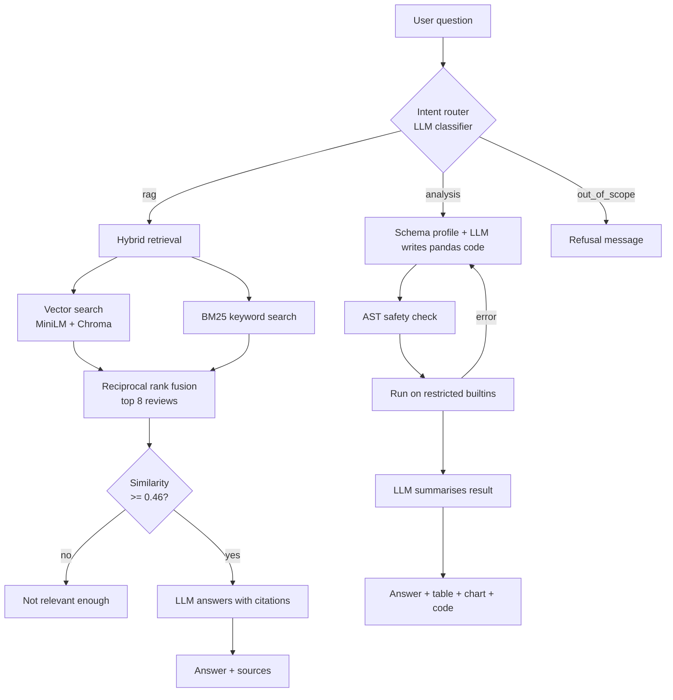
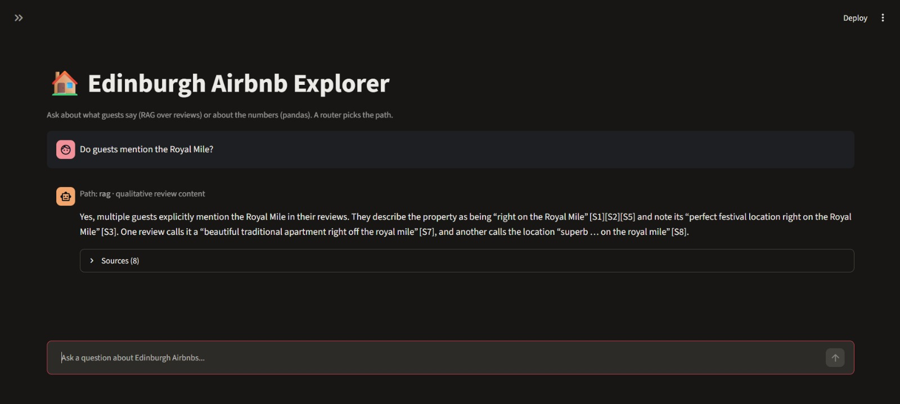
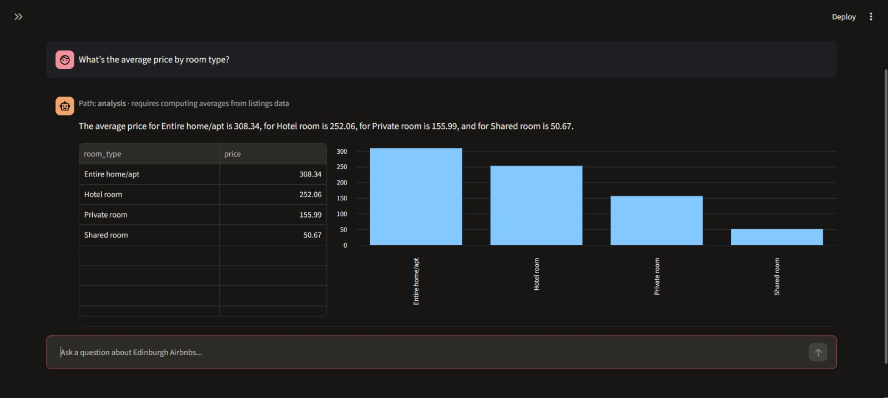
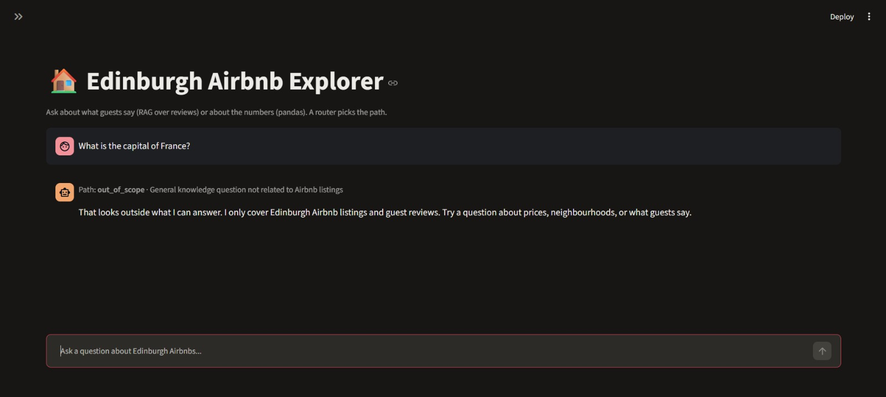

# 🏠 Edinburgh Airbnb Explorer

Chat with Edinburgh Airbnb data. Ask what guests say (RAG over 25,000 reviews) or ask for numbers (text-to-pandas over 6,342 listings). A small intent router picks the right engine for each question.

**Live demo:** https://airbnb-explorer-rag-and-data-analysis.streamlit.app/ 



## Try these questions

| Type | Question |
|---|---|
| Semantic (RAG) | What do guests complain about most? |
| Semantic (RAG) | Do guests say the area is noisy at night? |
| Semantic (RAG) | Do guests mention the Royal Mile? |
| Quantitative (pandas) | What's the average price by room type? |
| Quantitative (pandas) | Which 10 neighbourhoods have the most listings? |
| Quantitative (pandas) | How has the number of reviews changed by year? |
| Out of scope (refused) | What is the capital of France? |

## Why this is more than a standard RAG demo

A plain RAG app can't answer "average price by room type", because aggregates need computation, not retrieval. A plain data-analysis app can't answer "what do guests say about noise". This project combines both: an LLM intent classifier routes each question to RAG, pandas analysis, or a polite refusal.

## Architecture


## Dataset

**Source:** [Inside Airbnb](https://insideairbnb.com/get-the-data), Edinburgh, Scotland (public Airbnb listing data, one snapshot). Downloaded `listings.csv` and `reviews.csv`, then cleaned them with `build_data.py`.

| Table | Rows used | Key columns |
|---|---|---|
| Listings | 6,342 | neighbourhood, room_type, property_type, price, accommodates, bedrooms, number_of_reviews, review_scores (rating, cleanliness, location, value), host_is_superhost, availability_365 |
| Reviews | 25,000 (random sample) | listing_id, date, comments, plus neighbourhood and room_type joined from listings |

Reviews are English-filtered and 40 to 1,000 characters long. Prices are nightly asking prices in local currency.

**Stack:** Python, Streamlit, Groq (`openai/gpt-oss-20b` for routing and summaries, `openai/gpt-oss-120b` for answers and code), `sentence-transformers` (all-MiniLM-L6-v2), ChromaDB, `rank_bm25`, pandas. No LangChain or other framework.

**Data:** [Inside Airbnb](https://insideairbnb.com/get-the-data) Edinburgh listings plus a 25,000-review random sample (English-filtered, 40 to 1,000 characters).

## Screenshots

**RAG answer with citations** (the Sources expander shows the 8 retrieved reviews with similarity scores):



**Pandas analysis with table and chart** (an expander shows the code that ran):



**Out-of-scope refusal:**



## Features

- **Intent router:** an LLM classifier sends each question to RAG, pandas analysis, or an out-of-scope refusal, and shows its reasoning in the UI.
- **Hybrid retrieval:** vector search (MiniLM embeddings in Chroma) combined with BM25 keyword search through reciprocal rank fusion, over 25,000 guest reviews.
- **Grounded answers with citations:** every claim cites a numbered source, so the answer can be verified against the retrieved reviews shown in the UI. The prompt forbids frequency claims ("most common") that an 8-review sample can't support.
- **Text-to-pandas analysis:** the LLM writes pandas code from an auto-generated schema profile, with one automatic retry that feeds the error back.
- **Code safety guard:** an AST check blocks imports, dunder access and file I/O, and code runs with restricted builtins (demo-level, not a full sandbox).
- **Transparent UI:** shows the chosen path, retrieved sources with similarity scores, the code that ran, and an auto-generated table and chart side by side.
- **Evaluation suite:** router accuracy, retrieval hit@k / MRR / precision@5, analysis correctness against pandas ground truth, and a vector vs. hybrid comparison.
- **Runs on a laptop:** CPU-only embeddings, free Groq tier, precomputed index.

## Failure handling

| Layer | What it does |
|---|---|
| Router | Sends clearly off-topic questions (general knowledge, poems, sports) to a refusal and never touches retrieval or code. |
| Similarity threshold (0.46) | Catches off-topic questions that slip through to RAG. Chosen from measured scores: lowest in-domain 0.513, highest off-topic 0.415. |
| Prompt rule | Returns "not enough evidence" when on-topic reviews don't answer the question. |
| Code retry | Failed pandas code is retried once with the error fed back, then a friendly message is shown along with the code. |
| Router fallback | If the router output can't be parsed, the question defaults to RAG. |
| App safeguards | Retry with backoff on rate limits, friendly error messages, and a 15-question cap per session. |

## Evaluation

All numbers come from small hand-written test sets (32 router questions, 24 retrieval questions, 17 analysis questions). They show the pipeline works, not that it is robust at scale.

| Component | Metric | Result |
|---|---|---|
| Router | Accuracy, clear questions (24) | 24/24 |
| Router | Accuracy, ambiguous questions (8, labels by my own rule) | 6-7/8 across runs |
| Analysis | Scalar / grouped / top-N questions | 9/9, 5/5, 3/3 (17/17 overall) |

### Hybrid vs. vector retrieval (24 paraphrased questions)

| Metric | Vector only | Hybrid (BM25 + vector, RRF) |
|---|---|---|
| hit@1 | 20/24 | **23/24** |
| hit@3 | 23/24 | **24/24** |
| hit@5 | 24/24 | 24/24 |
| hit@8 | 24/24 | 24/24 |
| MRR | 0.892 | **0.979** |
| precision@5 | 0.825 | 0.825 |

- Hybrid puts a relevant review at rank 1 for 3 more questions (hit@1 up 12.5 points, MRR up 0.087).
- precision@5 did not change: hybrid reorders results better but does not add more relevant reviews to the top 5.
- **Caveat:** relevance is judged by keyword match, and BM25 matches the same kind of keywords, so it has a built-in advantage on this metric. The true gain is likely smaller. A human-labelled set would be a fairer test.

**Metric definitions:** hit@k is the share of questions with at least one relevant review in the top k. MRR averages 1/rank of the first relevant review. precision@5 is the share of the top 5 results that are relevant.

## A data finding

Nightly prices contain extreme outliers: the highest listed price is 12,042, while the mean price of an Entire home/apt is 308.34. Averages are pulled up by a few listings, so medians are the more reliable summary for this data.

## Limitations

- Reviews are a 25k random sample, so review counts are not totals. 2026 is a partial year, so its dip in the yearly chart is not a real decline.
- RAG sees only the top 8 retrieved reviews, so it cannot say what is "most common". Exact frequencies would need classifying every review.
- Retrieval relevance is scored by keyword match, not human labels.
- The ambiguous router labels follow my own rule (needs numbers = analysis, asks for opinions = rag), so that score is less certain.
- The code guard is a demo-level safeguard, not a security sandbox. For production I would run generated code in an isolated container.
- Each question goes down one path only. Mixed questions such as "which area is cheapest and what do guests say about it" are not supported.
- The evaluation corpus is small, so the results are indicative rather than conclusive.
- The English filter is crude (it keeps mostly-ASCII text).

## Run locally

```bash
git clone https://github.com/aishwaryavaidya05/airbnb-explorer-rag-and-data-analysis-using-hybrid-retrieval.git
cd airbnb-explorer-rag-and-data-analysis-using-hybrid-retrieval
python -m venv venv
venv\Scripts\activate
pip install -r requirements.txt
```

Set your free Groq key (PowerShell), then start the app:

```bash
$env:GROQ_API_KEY="your_key"
streamlit run app.py
```

To rebuild the data from scratch, download Edinburgh `listings.csv` and `reviews.csv` from Inside Airbnb into `data/` and run `python build_data.py`. To reproduce the evaluation, run `python eval.py` and `python compare_retrieval.py`.

## Project structure

| File | Purpose |
|---|---|
| `app.py` | Streamlit UI |
| `router.py` | Intent classifier (rag / analysis / out_of_scope) |
| `rag.py` | Vector-only retrieval and answer generation (baseline) |
| `hybrid.py` | Hybrid retrieval (vector + BM25 + RRF) and answer generation |
| `analysis.py` | Schema profiling, text-to-pandas, safety guard |
| `llm.py` | Single Groq wrapper with retry |
| `build_data.py` | Cleans data, builds embeddings and the Chroma index |
| `eval.py` | Router, retrieval and analysis evaluation |
| `compare_retrieval.py` | Vector vs. hybrid comparison |
| `check_threshold.py` | Measures the similarity threshold |
